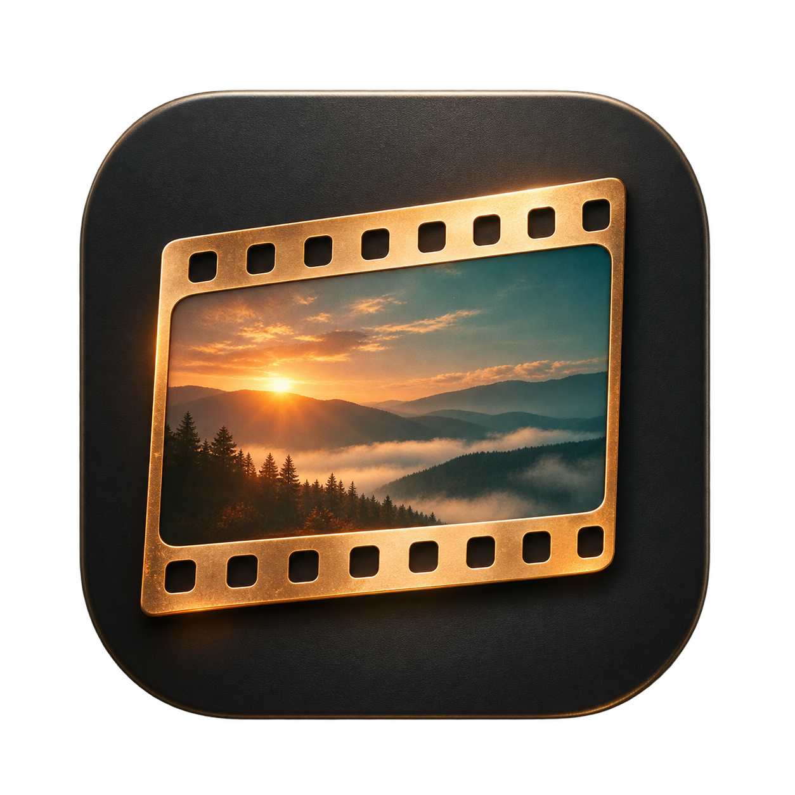

# Film Border

A local desktop app for adding film rebate borders to photos with the SpektraLab engine. Your original photo is left untouched; the bordered image is saved as a separate file.

## Features

- Choose from common film stock profiles, including Portra, Ektar, Gold, Ultramax, Pro 400H, C200, X-Tra 400, Provia 100F, Velvia 100, and CineStill 800T.
- Match 135 full-frame or half-frame photos, and 120 6×4.5, 6×6, or 6×7 formats.
- Change the film stock or frame format, then click **Generate** when you are ready to render.
- Set the frame number shown on the border; it advances after export.
- Process photos locally on your computer.

## Platforms

- Windows x64 (Vulkan): installer and generation flow tested.
- macOS on Apple silicon (macOS 15 or later): build and generation flow verified. The current macOS app is ad-hoc signed and is not notarized.

## Source and third-party notices

This project uses the SpektraLab engine and its film profiles. Their source and applicable license notices are included in [THIRD_PARTY_NOTICES.md](THIRD_PARTY_NOTICES.md) and [licenses](licenses/). The engine archive and built installers are not stored in this repository.

This repository does not yet specify a license for the original application code. The included third-party components remain under their respective licenses.

Instant-film scan and border replacement support is a future direction.
